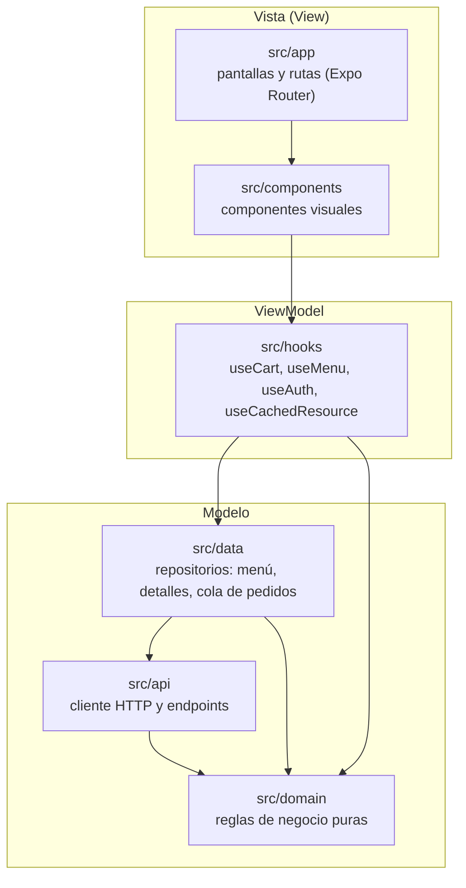

# Arquitectura de la app

La app sigue **Clean Architecture** con **MVVM** para la interfaz: cada capa solo depende de
las de abajo. Las reglas de dependencia **las revisa ESLint** ([`eslint.config.js`](../eslint.config.js)):
si un archivo importa una capa de arriba, `npx expo lint` y el pipeline fallan.



| Capa | Carpeta | Responsabilidad | No puede importar |
|---|---|---|---|
| Vista | `src/app`, `src/components` | Dibujar y reaccionar al usuario | `src/app` desde componentes |
| ViewModel | `src/hooks` | Estado de pantalla: cargar, guardar, sin conexión | Vista |
| Datos (repositorios) | `src/data` | De dónde salen los datos: memoria, teléfono o servidor | Vista, ViewModel |
| API | `src/api` | HTTP, sesión, convertir JSON en modelos | Vista, ViewModel, Datos |
| Dominio | `src/domain` | Reglas del negocio: carrito, cuentas, mesas, búsqueda | React, Expo, red y cualquier otra capa |

Los imports de **solo tipos** (`import type`) se permiten entre capas porque desaparecen al
compilar.

## Patrones de diseño

| Patrón | Tipo | Dónde | Para qué | Prueba |
|---|---|---|---|---|
| **Singleton** | Creacional | [`src/api/token-storage.ts`](../src/api/token-storage.ts) | Una sola instancia del token de sesión: se lee del Keystore/Keychain una vez y la comparten el cliente HTTP, el inicio de sesión y el cierre de sesión | [`test/patrones/singleton-token.test.ts`](../test/patrones/singleton-token.test.ts) |
| **Factory** | Creacional | [`src/domain/bills.ts`](../src/domain/bills.ts) → `createBills()` | Crea las cuentas a cobrar según cómo paga la mesa (junto, por separado o una persona) | [`test/patrones/factory-cuentas.test.ts`](../test/patrones/factory-cuentas.test.ts) |
| Factory (de modelos) | Creacional | `toProducts` ([`catalog.ts`](../src/api/catalog.ts)), `toOrder` ([`account.ts`](../src/api/account.ts)), `toTable` ([`waiter.ts`](../src/api/waiter.ts)), con los lectores seguros de [`parse.ts`](../src/api/parse.ts) | Crean los modelos de la app a partir del JSON del servidor, con valores seguros si falta un campo | [`test/patrones/factory-modelos.test.ts`](../test/patrones/factory-modelos.test.ts), [`test/modelos/parse.test.ts`](../test/modelos/parse.test.ts) |
| **Repository** | Estructural | [`src/data/product-details.ts`](../src/data/product-details.ts), [`src/data/waiter-outbox.ts`](../src/data/waiter-outbox.ts) | Un solo punto de acceso a los datos; decide si salen de la copia de la app, del teléfono o del servidor | [`test/patrones/repository-detalles.test.ts`](../test/patrones/repository-detalles.test.ts), [`test/casos-de-uso/waiter-outbox.test.ts`](../test/casos-de-uso/waiter-outbox.test.ts) |
| **Observer** | De comportamiento | [`src/api/client.ts`](../src/api/client.ts) → `onSessionExpired()`; cola de pedidos y detalles con `useSyncExternalStore` | Las pantallas se suscriben a cambios (sesión expirada, pedidos enviados, detalles nuevos) sin consultar a cada rato | [`test/patrones/observer-sesion.test.ts`](../test/patrones/observer-sesion.test.ts) |
| Provider / Context | Estructural | [`src/hooks/use-cart.tsx`](../src/hooks/use-cart.tsx), `use-auth.tsx` | Comparten un ViewModel con toda la app | [`test/controladores/carrito-viewmodel.test.tsx`](../test/controladores/carrito-viewmodel.test.tsx) |

## Pruebas de caja blanca (`/test`)

Las pruebas conocen el código por dentro y revisan la lógica interna con `expect`:

| Carpeta | Qué prueba | Ejemplos |
|---|---|---|
| `test/modelos` | Modelos y reglas del dominio | Carrito, cuentas de la mesa, búsqueda, validaciones, horarios, parseo del JSON |
| `test/casos-de-uso` | Flujos completos con la API simulada (`fetch` falso) | Inicio de sesión, pedidos sin conexión y su envío, cobro solo con internet, derechos ARCO |
| `test/controladores` | ViewModels (los controladores de MVVM) con React Native Testing Library | `useCart`: agregar, quitar, totales, guardar y recuperar del teléfono |
| `test/patrones` | Que cada patrón funcione como se describe arriba | Singleton, Factory, Repository, Observer |

```bash
npm test          # todas
npx jest test/patrones
```

Las pruebas del backend (Laravel) están en `la501-sports-web/tests` (Feature y Unit).
