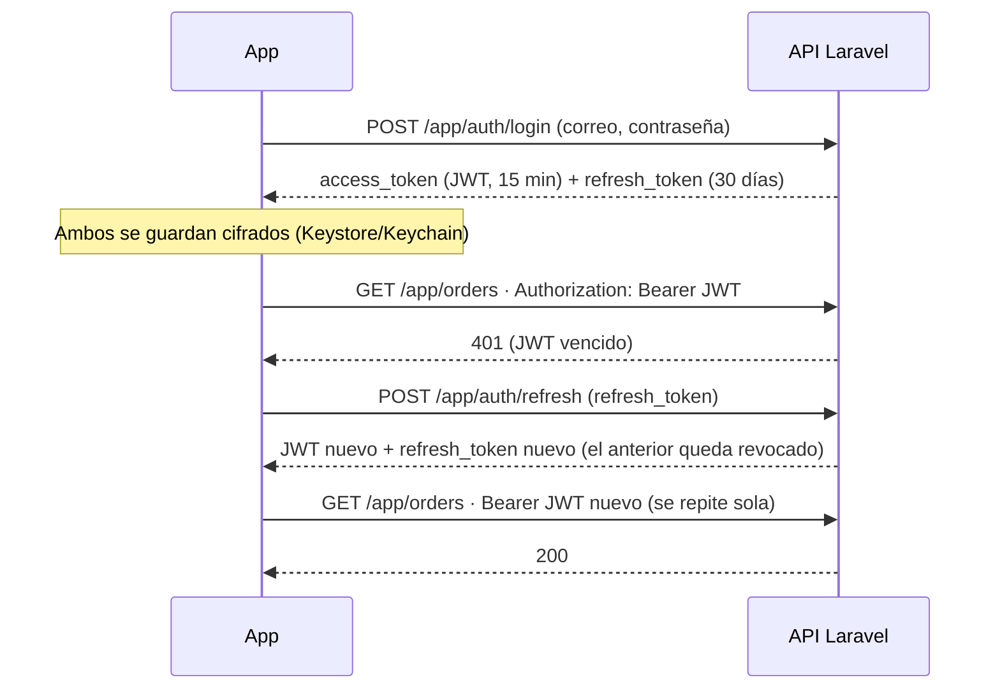

# Sesión segura: JWT, refresco por 401, almacenamiento cifrado y certificate pinning

| Requisito | Dónde | Pruebas |
|---|---|---|
| API REST con tokens **JWT Bearer** | Backend: `App\Services\JwtService`, guard `jwt` (`auth:jwt,sanctum`). App: `src/api/client.ts` manda `Authorization: Bearer <JWT>` | Backend `tests/Feature/JwtAuthTest.php`; app `test/casos-de-uso/sesion-jwt.test.ts` |
| **Interceptor para refresco 401** | `src/api/client.ts` → `refreshSession()` | `test/casos-de-uso/sesion-jwt.test.ts` |
| **Almacenamiento local cifrado** (EncryptedSharedPreferences / Keychain) | `src/api/token-storage.ts` con `expo-secure-store` | `test/patrones/singleton-token.test.ts`, `sesion-jwt.test.ts` |
| **Certificate pinning** (hash SHA-256 en el cliente HTTP) | `src/api/ssl-pinning.ts` + pines en `src/config/api.ts`, con `react-native-ssl-public-key-pinning` (**OkHttp CertificatePinner** en Android, TrustKit en iOS) | `test/casos-de-uso/ssl-pinning.test.ts` |
| Cifrado en tránsito | HTTPS obligatorio: `client.ts` no arranca si la API no usa `https://` | — |

## Flujo de la sesión



- **JWT de acceso:** firmado con HS256. Incluye `iss`, `sub`, `iat`, `nbf`, `exp`, `jti`, `typ` y `role`. Si la firma, el emisor o la vigencia no son válidos, o la cuenta está suspendida, el servidor responde 401.
- **Refresh token:** valor aleatorio de 64 caracteres. En la base solo se guarda su SHA-256.
  - Es de **un solo uso**: cada refresco entrega uno nuevo.
  - Si alguien reusa uno ya cambiado (señal de robo), se cierra toda la sesión.
  - Cerrar sesión, cambiar la contraseña o eliminar la cuenta lo revocan.
- **Interceptor:**
  - Ante un 401, renueva una sola vez y repite la petición.
  - Si varias peticiones fallan a la vez, comparten una sola renovación.
  - Si la renovación falla, la sesión termina y la app vuelve al inicio de sesión.
  - Si no hay internet, la sesión se conserva.
- **Transición:** las rutas aceptan JWT o Sanctum, así que las versiones anteriores de la app siguen funcionando.

## Certificate pinning

Hoy el servidor presenta esta cadena: `*.hostingersite.com` ← **Let's Encrypt YE1** ← **Root YE** ← ISRG Root X2.

El certificado propio del servidor se renueva cada pocas semanas. Por eso se fijan las
llaves de los **intermedios y raíces de Let's Encrypt** (activos y de respaldo): una
renovación sigue funcionando, pero un certificado emitido por cualquier otro (por ejemplo,
un proxy que intercepte la conexión) se rechaza.

Para calcular un pin:

```bash
# Cadena que presenta el servidor:
openssl s_client -connect lavender-ram-537394.hostingersite.com:443 -servername lavender-ram-537394.hostingersite.com -showcerts </dev/null
# Pin (SHA-256 de la llave pública, en base64) de un certificado:
openssl x509 -in cert.pem -pubkey -noout | openssl pkey -pubin -outform der | openssl dgst -sha256 -binary | base64
```

Certificados oficiales: https://letsencrypt.org/certificates/

**Mantenimiento**

- Los pines dejan de aplicarse el `2028-08-01` (`SSL_PINS_EXPIRATION`). Antes de esa fecha hay que publicar pines nuevos.
- **Si el servidor cambia de dominio o de autoridad certificadora** (por ejemplo, otra que no sea Let's Encrypt, o un dominio propio), hay que actualizar `SSL_PINS` *antes* del cambio. Si no, la app no podrá conectarse.
- **Prueba manual:** cambia un pin por uno falso, compila Release y comprueba que aparezca «No se pudo verificar que la conexión con el servidor sea segura».
- En Expo Go (desarrollo) no hay módulo nativo y la app se conecta sin pinning. Una compilación de producción sin pinning **no se conecta**.

## Pendiente en el servidor (Hostinger)

1. Desplegar la rama `feature/jwt-refresh` del backend.
2. Correr la migración de `refresh_tokens`: `php artisan migrate --force`.
3. Agregar en el `.env` un `JWT_SECRET` de 64 caracteres: `php -r "echo bin2hex(random_bytes(32));"`. Si no se agrega, se deriva de `APP_KEY`.
4. Limpiar la caché: `php artisan optimize:clear`.

Mientras eso no se haga, la app sigue funcionando con los tokens de Sanctum: lee `token` cuando no viene `access_token`.
